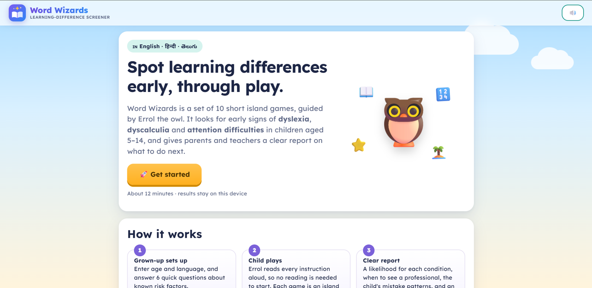
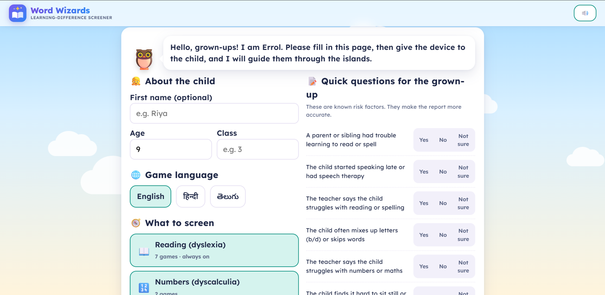
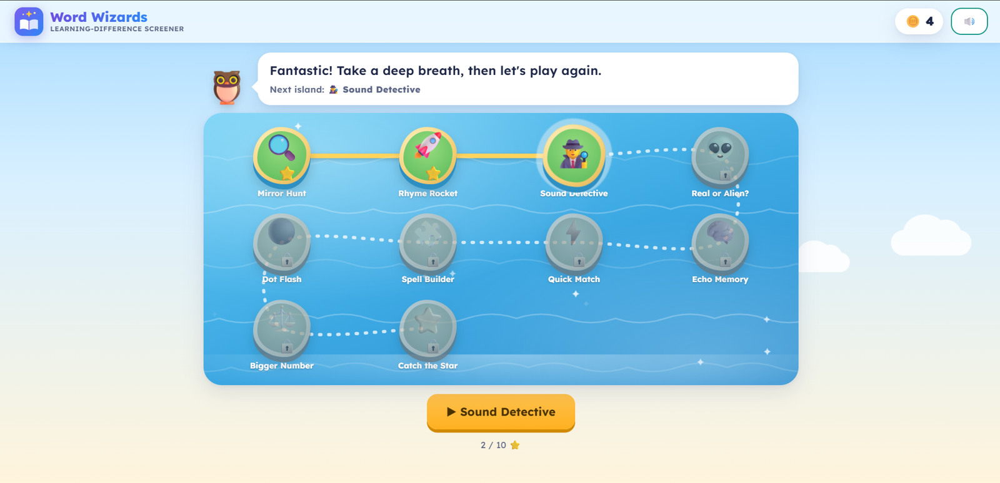
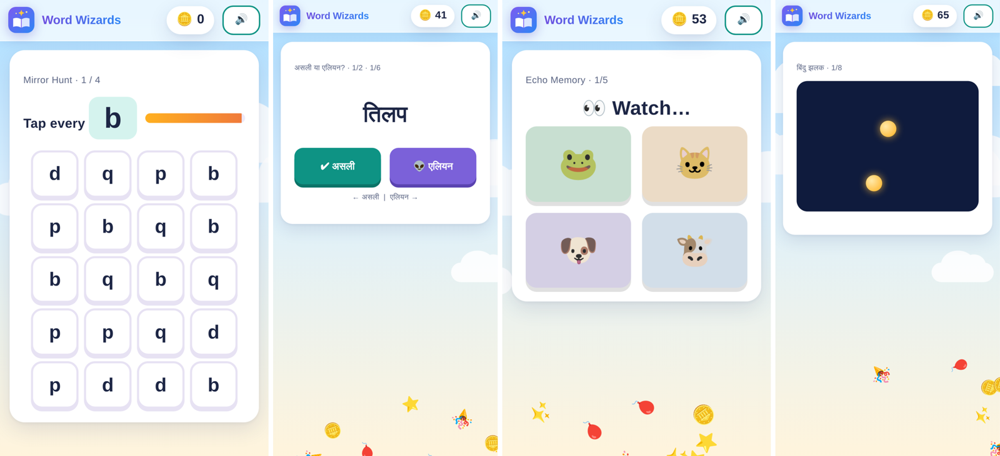
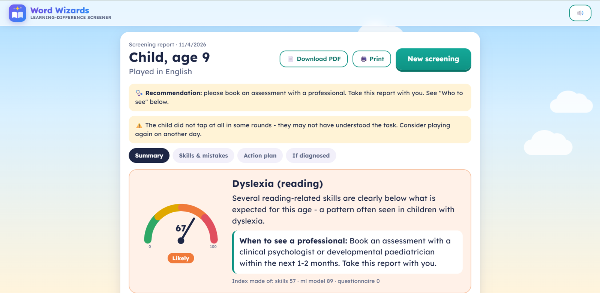
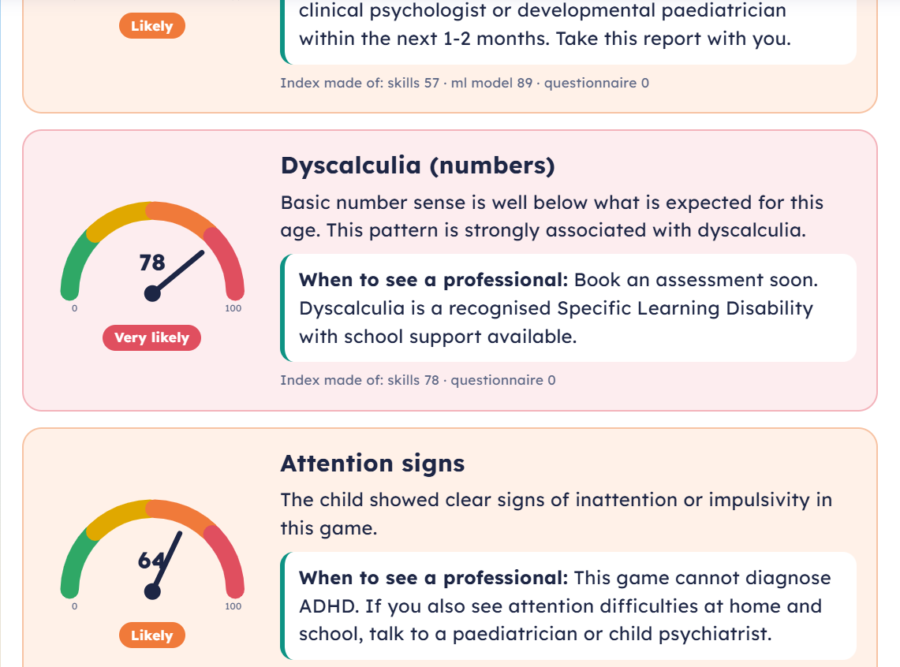
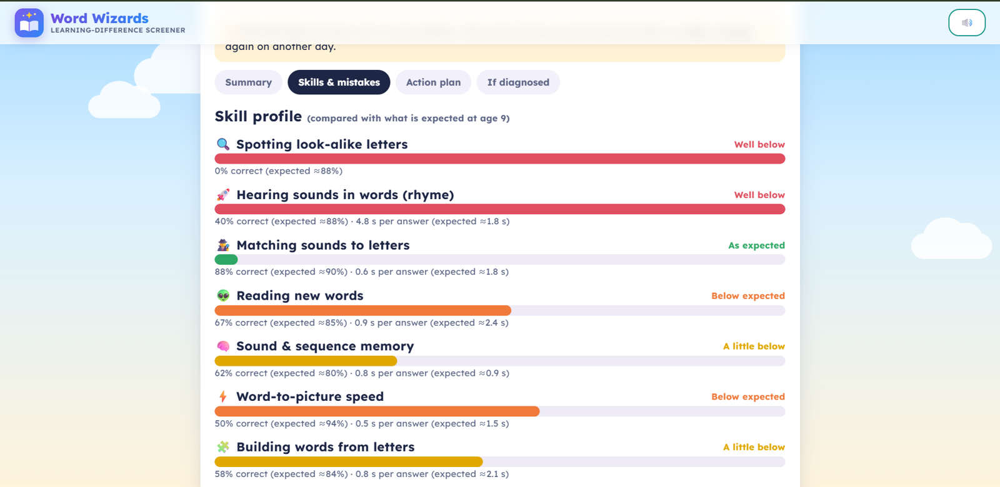
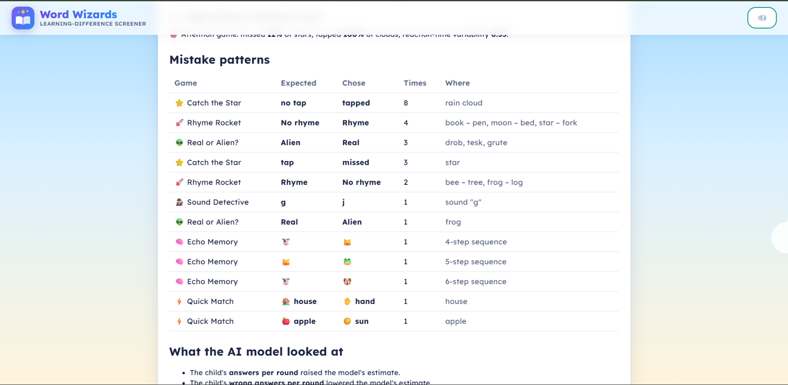
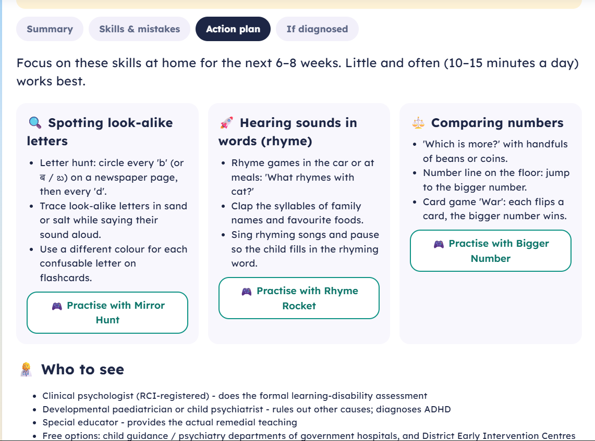
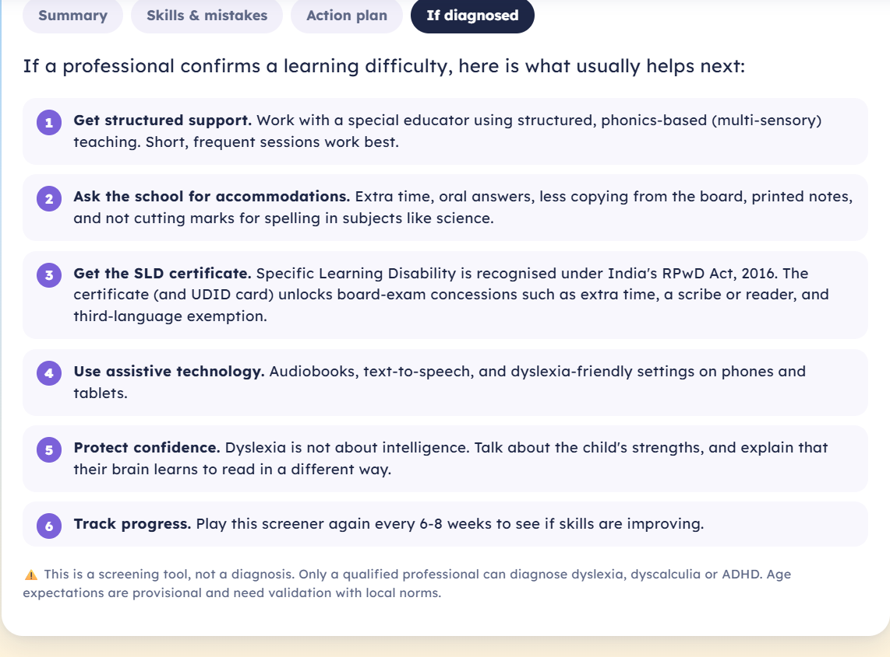

# Word Wizards

A game-based screener for dyslexia, dyscalculia and attention problems in children, in English, Hindi and Telugu.

Neural Storm 2026 · Track: Human Impact · Problem statement **HI-03** (Adaptive Learning for Students with Disabilities)

- Live demo: https://word-wizards-uix0.onrender.com (it runs on Render's free plan, so the first visit can take about a minute to load)
- Demo video: _add the Drive link here_

This is a screening tool. It can't diagnose anything, and we haven't tested it with Indian children yet (more on that under Limitations).

## Team

| | |
|---|---|
| Team name | Terminal Breakers |
| Members | Manaswi C | Reenu P | Harshita V K |
| College | Nitte Meenakshi Institute of Technology |

## Why we built this

Somewhere around 5 to 15% of children have dyslexia. In India it usually gets noticed late, after a child has been struggling at school for years. We looked at the screening tools that exist and kept running into the same few problems:

- Most of them are in English. DALI, the screener developed at NBRC, covers Hindi, Marathi, Kannada and English, but there is nothing validated for Telugu.
- Many need a trained adult to run them, a paid school licence, or special hardware (Lexplore, for example, uses eye-tracking).
- Hindi and Telugu are spelled almost exactly the way they sound. Children with dyslexia in these languages often read correctly but slowly, so a test that only counts mistakes can miss them.
- Dyslexia, dyscalculia and ADHD often come together. A child with one is 2 to 3 times more likely to have another, but most tools check for one thing.
- Parents get a score and no idea what to do with it.

For HI-03 we narrowed the problem to this: early screening, through games, for children who may have a learning disability, in Indian languages, followed by a practice plan for each child's weak areas.

## What the app does

A parent or teacher fills in a short setup page: the child's age and class, the language, which checks to run, and six yes/no questions about known risk factors (family history of reading trouble, late speech, and so on).

Then the child plays up to 10 one-minute games on an island map. Errol the owl reads out every instruction, so a child who can't read yet can still play.

| Game | What it checks |
|---|---|
| Mirror Hunt | telling apart look-alike letters (b/d, ब/व, ప/వ) |
| Rhyme Rocket | hearing whether two words rhyme (no reading needed) |
| Sound Detective | matching a spoken sound to its letter |
| Real or Alien? | reading made-up words |
| Echo Memory | remembering a sequence |
| Quick Match | how fast a spoken word is linked to a picture |
| Spell Builder | building a word from letter tiles, with one look-alike tile as a trap |
| Dot Flash | seeing how many dots there are without counting |
| Bigger Number | comparing numbers (place value for children 8 and up) |
| Catch the Star | tapping stars and holding back on rain clouds (attention and impulse control) |

Each answer counts once, with no retries. The app saves accuracy, response time, and every mistake (what the right answer was and what the child picked).

At the end, the parent gets a report with:

- a score from 0 to 100 for each condition, in four bands (Unlikely, Possible, Likely, Very likely), with a plain explanation and advice on whether and when to see a professional
- each skill compared with what we expect at the child's age
- the child's mistakes grouped into patterns, for example "picked ब instead of व, 3 times"
- home activities for the three weakest skills, and a button to practise each one in the game
- who to see in India, and what usually helps after a diagnosis (school accommodations, the SLD certificate under the RPwD Act 2016, assistive technology)
- a chart of past results if the child is screened again, and a PDF download

## How the score is calculated

For dyslexia:

```
index = 0.7 × skill score + 0.3 × ML model score + questionnaire points (max 15)
```

The skill score compares the child's accuracy in each reading game with what we expect at that age, measured from chance level. Slow answers add to the score on top of mistakes, with more weight for Hindi and Telugu. A child answering at random always ends up high, and a child who is accurate but very slow in Telugu still gets flagged.

The ML model is an XGBoost classifier on summary features (accuracy, miss rate, hits, clicks, age). The report shows the three features that pushed its estimate up or down, using SHAP values.

Bands: under 25 Unlikely, 25 to 49 Possible, 50 to 74 Likely, 75 and above Very likely.

Dyscalculia uses the two number games plus the questionnaire. The attention score uses missed stars, taps on clouds, and how much the reaction time varies. The report also warns when the child seemed to be tapping at random, and when attention problems may have pulled down the other scores.

## Model results

We trained on the open dataset from Rello et al. (2020), "Predicting risk of dyslexia with an online gamified test" (PLOS ONE). It has 3,644 participants, 392 of them with a professional dyslexia diagnosis. We used 5-fold stratified cross-validation and picked the decision threshold that gave the best balanced accuracy.

| Model | Features | ROC-AUC | Recall | Precision | Balanced accuracy |
|---|---|---|---|---|---|
| Baseline (always predicts "no dyslexia") | none | 0.50 | 0.00 | n/a | 0.50 |
| Full model | 193 per-exercise features | 0.857 | 0.791 | 0.300 | 0.784 |
| Portable model (used in the app) | 10 summary features | 0.775 | 0.760 | 0.205 | 0.702 |

The full model gets close to the paper's own result (a little over 80% recall), so we're fairly confident the pipeline is right. The app uses the portable model because our games are different from the ones in the study. It only needs summary numbers that any of our games can produce, in any language, and it loses only a few points of recall for that.

Precision is low on purpose. Only about 11% of the dataset has dyslexia, and for a screener, missing a child is worse than sending one for an extra check.

To reproduce: `python ml/train.py data/Dyt-desktop.csv`. Results are written to `models/metrics.json` and `models/shap_summary.png`.

## Tech stack

| Part | What we used |
|---|---|
| ML | Python: XGBoost, scikit-learn, pandas, NumPy. SHAP values come from XGBoost's `pred_contribs` on the server; the `shap` library is used for the training plot. |
| Scoring | `app/scoring.py` (Python) |
| Backend | FastAPI and Uvicorn |
| Frontend | HTML, CSS and JavaScript, no framework. Sound effects use the Web Audio API; the map, gauges and charts are SVG. |
| Speech | Microsoft Edge neural voices through the `edge-tts` package (Neerja for English, Swara for Hindi, Shruti for Telugu), saved as mp3 files. gTTS and the browser's own voice are fallbacks. |
| PDF report | html2pdf.js, bundled with the app |
| Hosting | Docker on Render (free plan) |

## Running it locally

```bash
git clone https://github.com/Manaswi0718/Dyslexia-Screener.git
cd Dyslexia-Screener
python -m venv venv
venv\Scripts\activate            # Mac/Linux: source venv/bin/activate
pip install -r requirements.txt
uvicorn app.main:app --reload    # then open http://127.0.0.1:8000
```

The trained model and the audio files are in the repo, so the app works right after installing.

Optional steps:

```bash
# retrain the model (download the dataset from https://doi.org/10.34740/kaggle/dsv/1617514 into data/)
python ml/train.py data/Dyt-desktop.csv

# regenerate the spoken audio (needs internet)
python tools/gen_audio.py
```

With Docker: `docker build -t word-wizards .` and then `docker run -p 7860:7860 word-wizards`, then open http://localhost:7860.

### Folders

```
app/main.py            FastAPI app, serves the games and /api/report
app/scoring.py         skill scores, the likelihood index, report text
ml/train.py            trains and evaluates the two models
models/                trained model, metrics.json, shap_summary.png
static/index.html      the whole front end (landing, setup, map, games, report)
static/content.json    all words and instructions in English, Hindi and Telugu
static/audio/          pre-generated speech
tools/                 scripts for audio and content
Dockerfile             used for deployment
```

## Screenshots

Landing page


Setup page (Errol talks here, and the parent answers the risk-factor questions)


The island map


On a phone: Mirror Hunt, Real or Alien? (Hindi), Echo Memory, Dot Flash (Hindi)


Report summary



Skills compared with age expectations


Mistake patterns


Action plan, and what to do after a diagnosis
| | |
|---|---|
|  |  |

## Limitations and what's needed next

- We have not tested this with Indian children. The model was trained on Spanish-speaking participants doing different exercises, so we don't know yet how accurate the full app is in Hindi, Telugu or English.
- The age expectations are our own estimates based on how hard each task is. They are not measured norms.
- The attention game can't diagnose ADHD. It only flags signs worth mentioning to a doctor.

Before anyone could use this professionally, it would need a pilot with a few hundred children per language, including children already diagnosed by psychologists (NBRC or a child guidance clinic would be good partners). That would give real sensitivity and specificity numbers and age norms for each language and class. It would also need a test-retest check, ethics approval, and compliance with India's Digital Personal Data Protection Act, 2023.

## Ethics and privacy

- The parent ticks a consent box before starting. There are no accounts. The server only calculates the report and keeps nothing; past results stay in the browser.
- The report never says a child "has" a condition. Every page carries a disclaimer, and the report recommends a professional assessment whenever any score is Likely or higher.
- We used no real children's data. We tested with our own play-throughs and with automated test players.

## AI tools used

- Claude (Anthropic): planning, research on existing screeners and the evidence behind each game, help writing and debugging code, and drafting this README.
- _Add any other tools you used._

We read, ran and tested all the AI-generated code ourselves.

## References

- Rello, L., Baeza-Yates, R., Ali, A., Bigham, J. P., & Serra, M. (2020). Predicting risk of dyslexia with an online gamified test. PLOS ONE 15(12): e0241687. Dataset: https://doi.org/10.34740/kaggle/dsv/1617514 (see the Kaggle page for its licence).
- DALI (Dyslexia Assessment for Languages of India), National Brain Research Centre.
- van Bergen, E. et al. (2025). Co-occurrence and causality among ADHD, dyslexia, and dyscalculia. Psychological Science.
- Rights of Persons with Disabilities Act, 2016.
- html2pdf.js (MIT licence). Fonts: Lexend, Noto Sans Devanagari and Noto Sans Telugu (Google Fonts, OFL).
