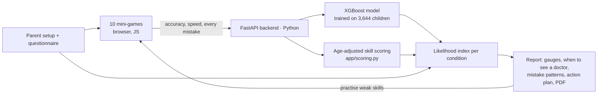

# 🦉 Word Wizards: spot learning differences early, through play

**Neural Storm 2026 · Track: Human Impact · Problem statement HI-03: Adaptive Learning for Students with Disabilities**

Word Wizards is a set of 10 short island games, guided by Errol the owl, that screens children aged 5–14 for early signs of **dyslexia**, **dyscalculia** and **attention difficulties**. It works in **English, Hindi and Telugu**. Parents and teachers get a clear report: a likelihood for each condition, when to see a professional, the child's exact mistake patterns, and an action plan with adaptive practice games.

🔗 **Live demo:** _add your Render link here_ (free hosting: the first visit may take about 1 minute to wake up) · 🎬 **Demo video:** _add your Drive link here_

> ⚠️ Word Wizards is a **screening tool, not a diagnosis**. It has not yet been validated with Indian children (see [Validation roadmap](#-limitations--validation-roadmap)).

---

## 👥 Team

| Team name | _your team name_ |
|---|---|
| Members | _Name (role)_ |
| College | _your college_ |

---

## 🧩 The problem

- Dyslexia affects an estimated **5–15% of children**. In India it is usually noticed only after years of "wait to fail", when the best window for support has already passed.
- Most screening tools are **English-only, paid, or need special hardware or a trained administrator**. India's own validated tool, DALI (NBRC), covers Hindi, Marathi, Kannada and English, but **not Telugu**.
- In **regular scripts** like Hindi and Telugu (spelled almost exactly as they sound), dyslexic children often read **correctly but slowly**. English-style tools that only count errors miss them.
- Learning differences **often occur together**: a child with one condition is 2–3 times more likely to have another. Most screeners only check one.
- Parents get a score but **no clear next step**.

We narrowed HI-03 to: **early, game-based screening that adapts to each child, plus a personalised practice plan, for children with or at risk of learning disabilities, in Indian languages.**

## 🔍 What existing tools do, and the gaps we fill

| Must-have in a good screener | Word Wizards |
|---|---|
| Phonological awareness | 🚀 Rhyme Rocket |
| Rapid naming / speed | ⚡ Quick Match |
| Letter–sound knowledge | 🕵️ Sound Detective |
| Decoding (made-up words) | 👽 Real or Alien? |
| Spelling | 🧩 Spell Builder (with a look-alike "trap" tile) |
| Working memory | 🧠 Echo Memory |
| Visual discrimination (b/d, ब/व, ప/వ) | 🔍 Mirror Hunt |
| Risk-factor questionnaire (family history, speech delay…) | ✅ 6 questions for the parent |
| Age-adjusted results | ✅ every skill compared with age expectations |
| Clear referral guidance | ✅ "When to see a professional" for each condition |

| Gap in existing tools | How we fill it |
|---|---|
| English-only, or no Telugu | English, **हिन्दी** and **తెలుగు**, with script-specific content (vowel marks, conjuncts, look-alike aksharas) |
| Need a trained adult to read the instructions | Errol **reads every instruction aloud** (neural Indian voices), so a child who can't read yet can still take part |
| Count errors only | Scores **speed as well as accuracy**, with more weight on speed for Hindi and Telugu |
| Screen one condition | **Reading + Numbers (dyscalculia) + Attention** modules |
| A score with no explanation | **Mistake patterns** ("picked ब instead of व, 3 times") plus what influenced the AI model |
| No next steps | Action plan, home activities, **adaptive practice games**, who to see in India, school accommodations, and **RPwD Act 2016** rights (SLD certificate → extra time, scribe, third-language exemption) |
| Paid / special hardware | Runs in any browser on phones and laptops; results stay on the device |

## 🎮 How it works

1. **Grown-up sets up**: age, class, language, which modules to run, and 6 quick risk-factor questions.
2. **Child plays**: 10 islands on an adventure map, each a 1-minute game. Errol guides and encourages; coins and stars keep children engaged. Every answer counts once (no retries), and every mistake is logged with what was expected, what was chosen and how long it took.
3. **Report**: a likelihood gauge (0–100) for each condition, in bands of **Unlikely / Possible / Likely / Very likely**, each with "what this means" and "when to see a professional". Plus a skill profile, mistake patterns, an action plan, "if diagnosed, what's next", a progress chart across re-screens, and a **PDF download**.



### How the likelihood index is calculated

For **dyslexia**:

`index = 0.7 × age-adjusted skill concern + 0.3 × ML model + questionnaire points (max 15)`

- **Skill concern (0–100)** for each skill compares the child's accuracy with the age expectation (relative to chance level). Slowness is added on top, weighted more heavily for Hindi and Telugu. As a result, a child who answers wrongly or at random always scores high, and a child who is accurate but very slow in Telugu is still flagged.
- **ML model**: XGBoost on summary features (accuracy, miss rate, hits, clicks, age). The top reasons are explained with **SHAP**.
- **Bands:** <25 Unlikely · 25–49 Possible · 50–74 Likely · ≥75 Very likely.
- **Dyscalculia** uses the two number games plus the questionnaire. **Attention** uses missed stars, impulsive taps and reaction-time variability from the go/no-go game.
- **Data-quality check:** warns if the child seemed to tap at random, and notes when attention difficulties may have lowered other scores.

## 📊 Model performance

Trained on the open dataset from *Rello et al. (2020), "Predicting risk of dyslexia with an online gamified test", PLOS ONE*: **3,644 participants, 392 with a professional dyslexia diagnosis**. We used 5-fold stratified cross-validation, with the decision threshold chosen for balanced accuracy.

| Model | Features | ROC-AUC | Recall (dyslexia) | Precision | Balanced accuracy |
|---|---|---|---|---|---|
| Baseline (always "no dyslexia") | – | 0.50 | 0.00 | – | 0.50 |
| **Full model** | 193 per-exercise features | **0.857** | **0.791** | 0.300 | **0.784** |
| **Portable model** (used in the app) | 10 language-independent features | 0.775 | 0.760 | 0.205 | 0.702 |

- The full model matches the original paper (which reported over 80% recall), which validates our pipeline.
- The **portable model** gives up a little accuracy so that it works with *our* games in *any* language. It needs only summary features that every game produces.
- Precision is low by design. Only about 11% of the dataset has dyslexia, and a screener should favour **recall**, because missing a child is worse than a follow-up check.

Run `python ml/train.py data/Dyt-desktop.csv` to reproduce. The results are saved to `models/metrics.json` and `models/shap_summary.png`.

## 🛠️ Tech stack

| Layer | Tools |
|---|---|
| ML / AI (Python) | XGBoost, scikit-learn, pandas, NumPy, **SHAP** values (XGBoost `pred_contribs` on the server; `shap` for training plots) |
| Scoring engine (Python) | `app/scoring.py`: age-adjusted skill scores, likelihood index, guidance |
| Backend | FastAPI + Uvicorn |
| Frontend | Plain HTML/CSS/JavaScript (no framework), Web Audio API for sound effects, SVG for the map, gauges and charts |
| Speech | Microsoft Edge neural TTS via `edge-tts` (en-IN Neerja, hi-IN Swara, te-IN Shruti), pre-generated as mp3 files, with gTTS and the browser voice as fallbacks |
| PDF report | html2pdf.js (bundled locally) |
| Deployment | Docker on Render (free web service) |

## 🚀 Setup and run locally

```bash
git clone https://github.com/Manaswi0718/Dyslexia-Screener.git
cd Dyslexia-Screener
python -m venv venv
venv\Scripts\activate            # Mac/Linux: source venv/bin/activate
pip install -r requirements.txt

# (optional) retrain the model: download the dataset from
# https://doi.org/10.34740/kaggle/dsv/1617514 into data/, then:
python ml/train.py data/Dyt-desktop.csv

# (optional) regenerate the spoken audio (needs internet once)
python tools/gen_audio.py

uvicorn app.main:app --reload    # open http://127.0.0.1:8000
```

The trained model (`models/portable_model.joblib`) and the audio clips are included, so the app runs straight after `pip install`.

**Run with Docker:** `docker build -t word-wizards . && docker run -p 7860:7860 word-wizards`, then open http://localhost:7860

### Project structure

```
app/main.py            FastAPI: serves the games, /api/report
app/scoring.py         age-adjusted scoring, likelihood index, guidance text
ml/train.py            trains + evaluates the full and portable models
models/                trained model, metrics.json, shap_summary.png
static/index.html      the whole app: landing, setup, map, 10 games, report
static/content.json    all words and instructions in English, Hindi and Telugu
static/audio/          pre-generated speech (neural voices)
tools/                 audio generation and content scripts
Dockerfile             deployment
```

## 📸 Screenshots

**Landing page**


**Grown-up setup: Errol speaks, plus the risk-factor questionnaire**


**Island adventure map**


**On phones: Mirror Hunt, Real or Alien? (Hindi), Echo Memory, Dot Flash (Hindi)**


**Report: clear likelihood and when to see a professional**


**Report: skill profile compared with age expectations**


**Report: exact mistake patterns**


**Action plan with practice games, and what to do if diagnosed**
| | |
|---|---|
|  |  |

## 🧪 Limitations and validation roadmap

We want to be clear about what this prototype can and cannot claim:

- **Not yet validated with Indian children.** The model was trained on Spanish-speaking participants doing different exercises. The full app's real accuracy in Hindi, Telugu and English is unknown until it is tested.
- **The age expectations are provisional.** They were set from task difficulty, not measured norms.
- **The attention module cannot diagnose ADHD.** It only flags signs worth discussing with a doctor.

**To make it professional-grade:**
1. A pilot with a few hundred children per language, including children diagnosed by psychologists (for example, in partnership with NBRC / DALI or child-guidance clinics), to measure sensitivity and specificity.
2. Age norms per language and class from that data.
3. Test–retest reliability.
4. Ethics approval and compliance with India's Digital Personal Data Protection Act, 2023.

## 🔒 Ethics and privacy

- A consent checkbox before starting. No accounts, and nothing is stored on a server: the backend only computes the report, and session history stays in the browser.
- Wording is careful and non-diagnostic, every page carries a disclaimer, and the report advises a professional assessment whenever anything is Likely or above.
- No real children's data was used. Testing was done by the team and with automated test players.

## 🤖 AI tools used

- **Claude (Anthropic)**: planning, research (existing screeners, the research behind the indicators, Indian legal context), code generation and debugging, and drafting this README.
- _Add any others you used (for example ChatGPT or Copilot)._

All AI-generated code was reviewed, run and tested by the team.

## 📚 Credits and references

- Rello, L., Baeza-Yates, R., Ali, A., Bigham, J. P., & Serra, M. (2020). *Predicting risk of dyslexia with an online gamified test.* PLOS ONE 15(12): e0241687. Dataset: https://doi.org/10.34740/kaggle/dsv/1617514 (see the Kaggle page for its licence).
- DALI: Dyslexia Assessment for Languages of India, National Brain Research Centre.
- van Bergen et al. (2025). *Co-occurrence and causality among ADHD, dyslexia, and dyscalculia.* Psychological Science.
- Rights of Persons with Disabilities Act, 2016 (Specific Learning Disabilities).
- html2pdf.js (MIT). Fonts: Lexend, Noto Sans Devanagari and Noto Sans Telugu (Google Fonts, OFL).
